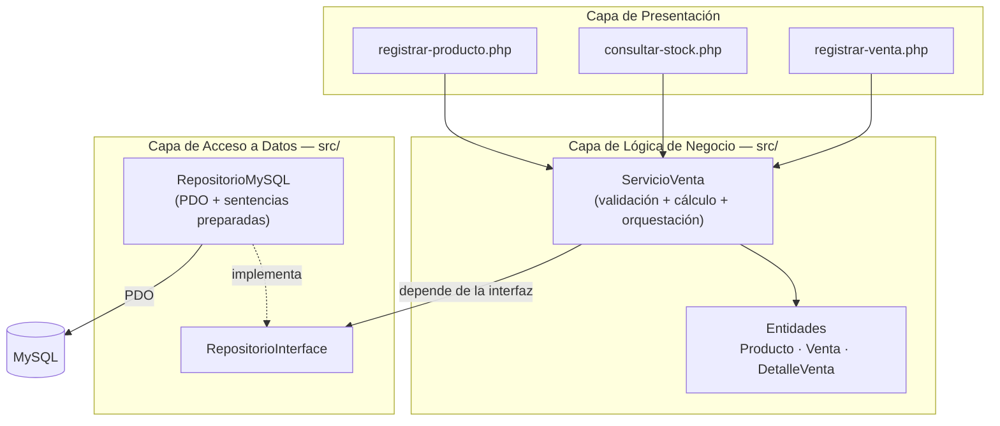
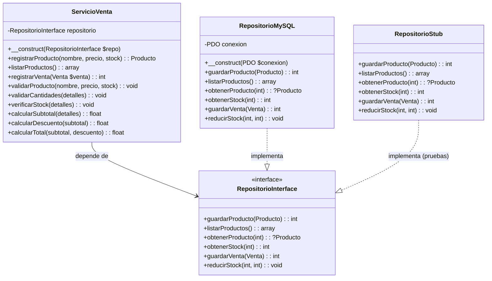
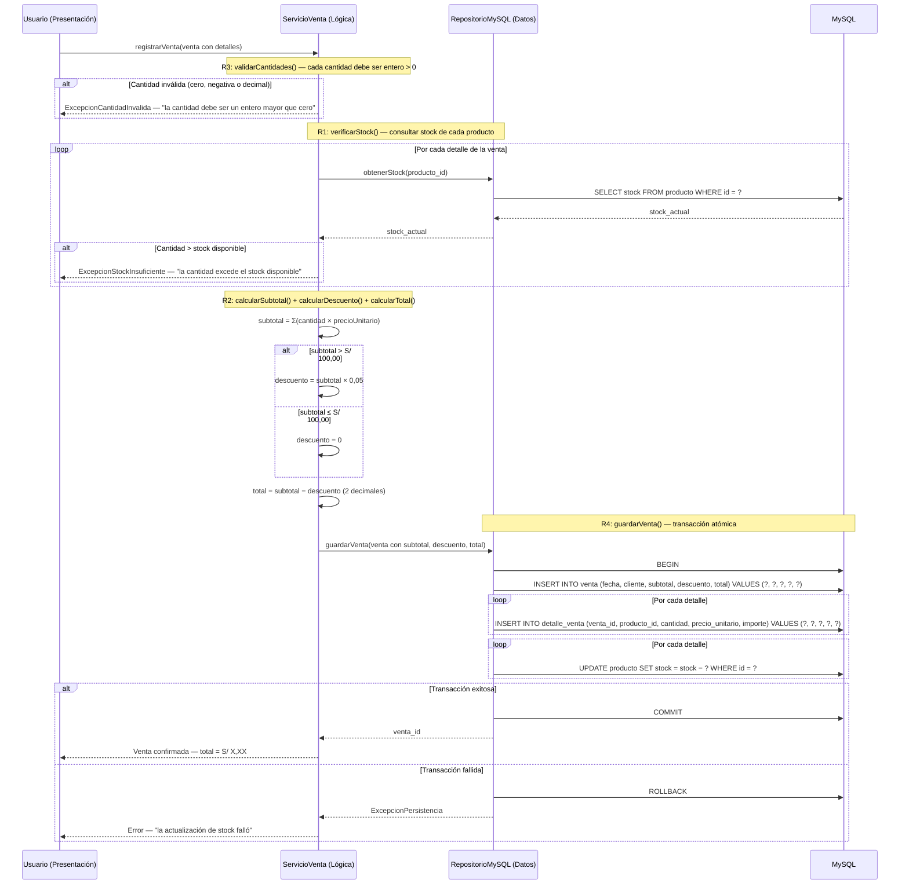
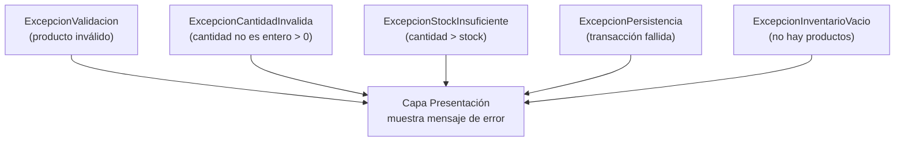

# Design Document — Registro de Ventas Bodega «Doña Rosa»

## Overview

El sistema de registro de ventas de la bodega «Doña Rosa» es una aplicación PHP 8 + MySQL que permite registrar productos, consultar stock, registrar ventas, aplicar descuentos por volumen y mantener el inventario actualizado. Se ejecuta en una sola computadora del local sobre Laragon, sin framework y sin librerías externas salvo PHPUnit.

### Decisiones de diseño principales

| Decisión | Justificación |
|----------|---------------|
| Arquitectura en tres capas | Separación de responsabilidades: la lógica de negocio no depende de HTML ni de SQL, lo que permite probar `ServicioVenta` con PHPUnit sin base de datos. |
| Inyección de dependencias vía interfaz | `ServicioVenta` recibe un `RepositorioInterface` en su constructor. En producción se inyecta `RepositorioMySQL`; en pruebas se inyecta un stub/mock que implementa la misma interfaz. |
| Transacción gestionada en la capa de datos | `RepositorioMySQL::guardarVenta()` envuelve la inserción de la venta, el detalle y la reducción de stock en una sola transacción, cumpliendo R4. |
| Entidades simples (POPO) | `Producto`, `Venta` y `DetalleVenta` son objetos PHP planos sin lógica ni dependencias, fáciles de instanciar en pruebas. |
| Validación y cálculo como lógica pura en `ServicioVenta` | Los métodos de validación (`validarProducto`, `validarCantidades`) y cálculo (`calcularSubtotal`, `calcularDescuento`, `calcularTotal`) no acceden al repositorio ni emiten HTML, por lo que son verificables con pruebas de propiedades. |

### Restricciones y alcance

- No incluye autenticación de usuarios, reportes ni facturación electrónica (fuera de alcance según D0.md).
- Entorno: Laragon en `C:\laragon\www\bodega`, MySQL root sin contraseña, PHP 8.
- Sin framework, sin librerías externas salvo PHPUnit.

---

## Architecture

### Diagrama de capas



### Descripción de cada capa

**1. Capa de Presentación** — Archivos `.php` que contienen HTML y formularios. Reciben la entrada del usuario por `$_POST`/`$_GET`, crean una instancia de `ServicioVenta` (con `RepositorioMySQL` inyectado) y muestran el resultado. No contiene lógica de validación ni cálculo; delega todo a `ServicioVenta`.

**2. Capa de Lógica de Negocio** — La clase `ServicioVenta` en `src/`. Contiene todas las reglas de negocio (R1–R4): validación de productos, validación de cantidades, verificación de stock, cálculo de subtotal/descuento/total y orquestación del guardado de la venta. No emite HTML ni ejecuta SQL. Depende de `RepositorioInterface`, no de `RepositorioMySQL` directamente, lo que permite inyectar un stub en las pruebas unitarias.

**3. Capa de Acceso a Datos** — La clase `RepositorioMySQL` en `src/` implementa `RepositorioInterface` y usa PDO con sentencias preparadas para todas las operaciones de base de datos. Gestiona la transacción atómica de guardado de venta y reducción de stock (R4).

### Inyección de dependencias y testeabilidad



En producción, la presentación crea `RepositorioMySQL` (conexión PDO real) y lo inyecta en `ServicioVenta`. En las pruebas unitarias, se inyecta `RepositorioStub` (o un mock de PHPUnit) que guarda datos en memoria, permitiendo probar toda la lógica de negocio sin tocar MySQL.

---

## Components and Interfaces

### src/Producto.php

Entidad que representa un producto del inventario.

```php
class Producto {
    private ?int $id;
    private string $nombre;
    private float $precio;   // DECIMAL(8,2)
    private int $stock;       // entero >= 0

    public function __construct(?int $id, string $nombre, float $precio, int $stock);
    // Getters y setters con validación básica
}
```

### src/DetalleVenta.php

Línea de detalle de una venta: un producto con su cantidad, precio unitario e importe calculado.

```php
class DetalleVenta {
    private int $productoId;
    private int $cantidad;         // entero > 0 (R3)
    private float $precioUnitario;  // DECIMAL(8,2)
    private float $importe;         // cantidad × precioUnitario

    public function __construct(int $productoId, int $cantidad, float $precioUnitario);
    public function getImporte(): float;  // calculado: cantidad × precioUnitario
}
```

### src/Venta.php

Entidad que agrupa los detalles de una venta y los totales calculados.

```php
class Venta {
    private ?int $id;
    private DateTime $fecha;
    private string $cliente;
    /** @var DetalleVenta[] */
    private array $detalles;
    private float $subtotal;   // Σ importe de cada detalle
    private float $descuento;  // 5 % si subtotal > 100, sino 0 (R2)
    private float $total;      // subtotal - descuento, redondeado a 2 decimales

    public function __construct(string $cliente, array $detalles);
    public function agregarDetalle(DetalleVenta $detalle): void;
    public function getDetalles(): array;
    // Getters y setters para subtotal, descuento, total
}
```

### src/RepositorioInterface.php

Contrato que define las operaciones de acceso a datos. `ServicioVenta` depende de esta interfaz, no de la implementación concreta, lo que habilita la inyección de mocks/stubs en las pruebas.

```php
interface RepositorioInterface {
    /** Guarda un producto y devuelve su ID generado. */
    public function guardarProducto(Producto $producto): int;

    /** Lista todos los productos, incluyendo los de stock cero. */
    public function listarProductos(): array;

    /** Obtiene un producto por su ID, o null si no existe. */
    public function obtenerProducto(int $id): ?Producto;

    /** Devuelve el stock actual de un producto por su ID. */
    public function obtenerStock(int $productoId): int;

    /**
     * Guarda la venta (cabecera + detalles) y reduce el stock de cada
     * producto en una transacción atómica (R4). Lanza excepción si
     * la transacción falla, revertiendo todos los cambios.
     * Devuelve el ID de la venta generada.
     */
    public function guardarVenta(Venta $venta): int;

    /** Reduce el stock de un producto en la cantidad indicada. */
    public function reducirStock(int $productoId, int $cantidad): void;
}
```

### src/RepositorioMySQL.php

Implementación de `RepositorioInterface` con PDO y sentencias preparadas.

```php
class RepositorioMySQL implements RepositorioInterface {
    private PDO $conexion;

    public function __construct(PDO $conexion);

    public function guardarProducto(Producto $producto): int;
    // INSERT INTO producto (nombre, precio, stock) VALUES (?, ?, ?)

    public function listarProductos(): array;
    // SELECT * FROM producto ORDER BY nombre

    public function obtenerProducto(int $id): ?Producto;
    // SELECT * FROM producto WHERE id = ?

    public function obtenerStock(int $productoId): int;
    // SELECT stock FROM producto WHERE id = ?

    public function guardarVenta(Venta $venta): int;
    // Transacción:
    //   BEGIN
    //   INSERT INTO venta (fecha, cliente, subtotal, descuento, total) VALUES (?, ?, ?, ?, ?)
    //   foreach detalle: INSERT INTO detalle_venta (venta_id, producto_id, cantidad, precio_unitario, importe) VALUES (?, ?, ?, ?, ?)
    //   foreach detalle: UPDATE producto SET stock = stock - ? WHERE id = ?
    //   COMMIT
    // Si cualquier paso falla: ROLLBACK y lanzar ExcepcionPersistencia

    public function reducirStock(int $productoId, int $cantidad): void;
    // UPDATE producto SET stock = stock - ? WHERE id = ?
}
```

### src/ServicioVenta.php

Clase central de lógica de negocio. No contiene HTML ni SQL.

```php
class ServicioVenta {
    private RepositorioInterface $repositorio;

    public function __construct(RepositorioInterface $repositorio);

    // --- Registro de productos (Req 1) ---

    public function registrarProducto(string $nombre, float $precio, int $stock): Producto;
    // 1. validarProducto() — lanza ExcepcionValidacion si los datos son inválidos
    // 2. repositorio->guardarProducto()
    // 3. devuelve el Producto guardado

    public function validarProducto(string $nombre, float $precio, int $stock): void;
    // Validaciones (sin acceso a BD):
    //   nombre no vacío
    //   precio > 0 y con máximo 2 decimales
    //   stock entero >= 0

    // --- Consulta de stock (Req 2) ---

    public function listarProductos(): array;
    // repositorio->listarProductos()
    // Si el arreglo está vacío, lanza ExcepcionInventarioVacio

    // --- Registro de ventas (Req 3 + Req 4 + Req 5) ---

    public function registrarVenta(Venta $venta): int;
    // 1. validarCantidades($venta->getDetalles())  — R3
    // 2. verificarStock($venta->getDetalles())     — R1
    // 3. subtotal = calcularSubtotal($venta->getDetalles())
    // 4. descuento = calcularDescuento(subtotal)    — R2
    // 5. total = calcularTotal(subtotal, descuento) — R2
    // 6. venta.setSubtotal/Descuento/Total(...)
    // 7. repositorio->guardarVenta($venta)         — R4
    // 8. devuelve venta->getId()

    public function validarCantidades(array $detalles): void;
    // R3: cada cantidad debe ser entero > 0
    // Lanza ExcepcionCantidadInvalida si alguna es <= 0 o decimal

    public function verificarStock(array $detalles): void;
    // R1: para cada detalle, obtener stock del repositorio y comparar
    // Lanza ExcepcionStockInsuficiente si cantidad > stock

    public function calcularSubtotal(array $detalles): float;
    // Σ (cantidad × precioUnitario) de cada detalle, redondeado a 2 decimales

    public function calcularDescuento(float $subtotal): float;
    // R2: si subtotal > 100.00 → descuento = subtotal × 0.05
    //     si subtotal <= 100.00 → descuento = 0
    // Redondeado a 2 decimales

    public function calcularTotal(float $subtotal, float $descuento): float;
    // total = subtotal - descuento, redondeado a 2 decimales
}
```

### Excepciones

```php
class ExcepcionValidacion extends Exception {}        // producto con datos inválidos
class ExcepcionCantidadInvalida extends Exception {} // cantidad no es entero > 0 (R3)
class ExcepcionStockInsuficiente extends Exception {} // cantidad > stock (R1)
class ExcepcionPersistencia extends Exception {}      // fallo de transacción (R4)
class ExcepcionInventarioVacio extends Exception {}   // no hay productos registrados
```

### config/conexion.php

Configuración de la conexión PDO para Laragon.

```php
$dsn = 'mysql:host=127.0.0.1;dbname=bodega;charset=utf8mb4';
$conexion = new PDO($dsn, 'root', '', [
    PDO::ATTR_ERRMODE => PDO::ERRMODE_EXCEPTION,
    PDO::ATTR_DEFAULT_FETCH_MODE => PDO::FETCH_ASSOC,
]);
```

### Archivos de presentación

| Archivo | Función |
|---------|---------|
| `presentacion/registrar-producto.php` | Formulario HTML para registrar un producto. Envía POST a `ServicioVenta::registrarProducto()`. |
| `presentacion/consultar-stock.php` | Muestra la tabla de productos con nombre, precio y stock. Llama a `ServicioVenta::listarProductos()`. |
| `presentacion/registrar-venta.php` | Formulario HTML para registrar una venta: seleccionar productos y cantidades. Envía POST a `ServicioVenta::registrarVenta()`. Muestra el total con descuento. |
| `presentacion/plantilla.php` | Cabecera y pie HTML comunes (nav simple, estilos básicos). |

### Diagrama de secuencia: Registrar venta (R1–R4)



---

## Data Models

### Diagrama entidad-relación

```mermaid
erDiagram
    producto {
        INT id PK
        VARCHAR(80) nombre
        DECIMAL(8,2) precio
        INT stock
    }

    venta {
        INT id PK
        DATETIME fecha
        VARCHAR(80) cliente
        DECIMAL(10,2) subtotal
        DECIMAL(10,2) descuento
        DECIMAL(10,2) total
    }

    detalle_venta {
        INT id PK
        INT venta_id FK
        INT producto_id FK
        INT cantidad
        DECIMAL(8,2) precio_unitario
        DECIMAL(10,2) importe
    }

    venta ||--o{ detalle_venta : "tiene"
    producto ||--o{ detalle_venta : "aparece en"
```

### Esquema SQL (sql/schema.sql)

```sql
CREATE TABLE producto (
    id     INT AUTO_INCREMENT PRIMARY KEY,
    nombre VARCHAR(80) NOT NULL,
    precio DECIMAL(8,2) NOT NULL,
    stock  INT NOT NULL DEFAULT 0
);

CREATE TABLE venta (
    id        INT AUTO_INCREMENT PRIMARY KEY,
    fecha     DATETIME NOT NULL DEFAULT CURRENT_TIMESTAMP,
    cliente   VARCHAR(80) NOT NULL DEFAULT 'Consumidor Final',
    subtotal  DECIMAL(10,2) NOT NULL,
    descuento DECIMAL(10,2) NOT NULL DEFAULT 0.00,
    total     DECIMAL(10,2) NOT NULL
);

CREATE TABLE detalle_venta (
    id             INT AUTO_INCREMENT PRIMARY KEY,
    venta_id       INT NOT NULL,
    producto_id    INT NOT NULL,
    cantidad       INT NOT NULL,
    precio_unitario DECIMAL(8,2) NOT NULL,
    importe        DECIMAL(10,2) NOT NULL,
    FOREIGN KEY (venta_id) REFERENCES venta(id) ON DELETE CASCADE,
    FOREIGN KEY (producto_id) REFERENCES producto(id)
);
```

### Descripción de tablas

**producto** — Mercancía disponible en el inventario. Cada producto tiene un nombre único visible, un precio unitario con dos decimales y un stock en unidades enteras.

| Columna | Tipo | Restricciones |
|---------|------|---------------|
| `id` | `INT` | PK, AUTO_INCREMENT |
| `nombre` | `VARCHAR(80)` | NOT NULL |
| `precio` | `DECIMAL(8,2)` | NOT NULL |
| `stock` | `INT` | NOT NULL, DEFAULT 0 |

**venta** — Cabecera de una transacción de venta. Registra la fecha, el cliente y los importes calculados.

| Columna | Tipo | Restricciones |
|---------|------|---------------|
| `id` | `INT` | PK, AUTO_INCREMENT |
| `fecha` | `DATETIME` | NOT NULL, DEFAULT CURRENT_TIMESTAMP |
| `cliente` | `VARCHAR(80)` | NOT NULL, DEFAULT 'Consumidor Final' |
| `subtotal` | `DECIMAL(10,2)` | NOT NULL |
| `descuento` | `DECIMAL(10,2)` | NOT NULL, DEFAULT 0.00 |
| `total` | `DECIMAL(10,2)` | NOT NULL |

**detalle_venta** — Línea de detalle de una venta. Asocia un producto con su cantidad, precio unitario e importe.

| Columna | Tipo | Restricciones |
|---------|------|---------------|
| `id` | `INT` | PK, AUTO_INCREMENT |
| `venta_id` | `INT` | FK → `venta(id)`, NOT NULL |
| `producto_id` | `INT` | FK → `producto(id)`, NOT NULL |
| `cantidad` | `INT` | NOT NULL |
| `precio_unitario` | `DECIMAL(8,2)` | NOT NULL |
| `importe` | `DECIMAL(10,2)` | NOT NULL |

---

## Correctness Properties

*A property is a characteristic or behavior that should hold true across all valid executions of a system — essentially, a formal statement about what the system should do. Properties serve as the bridge between human-readable specifications and machine-verifiable correctness guarantees.*

### Property 1: Validación de producto (bidireccional)

*For any* combination of nombre, precio and stock, `validarProducto()` acepta el producto **si y solo si** el nombre no es vacío, el precio unitario es mayor que cero con máximo dos decimales, y el stock es un entero mayor o igual a cero. Cuando se rechaza, el mensaje de error indica el campo inválido.

**Validates: Requirements 1.1, 1.3**

### Property 2: Validación de cantidades (bidireccional)

*For any* valor de cantidad, `validarCantidades()` acepta la cantidad **si y solo si** es un entero mayor que cero. Los valores cero, negativos y decimales son rechazados con el mensaje "la cantidad debe ser un entero mayor que cero".

**Validates: Requirements 3.2, 3.3**

### Property 3: Suficiencia de stock

*For any* venta con detalles y *any* configuración de stock por producto (mediante un repositorio stub), la venta se rechaza **si y solo si** alguna cantidad supera el stock disponible del producto correspondiente. Cuando la cantidad iguala el stock, la venta se acepta (caso límite). Al rechazarse, no se reduce el stock de ningún producto.

**Validates: Requirements 3.4, 3.5, 5.3**

### Property 4: Cálculo de subtotal

*For any* conjunto de detalles de venta, el subtotal calculado por `calcularSubtotal()` es igual a la suma de (cantidad × precio_unitario) de cada detalle, redondeado a dos decimales.

**Validates: Requirements 4.1, 4.2**

### Property 5: Cálculo de descuento y total

*For any* subtotal, `calcularDescuento()` devuelve el 5 % del subtotal si el subtotal es mayor a S/ 100,00, y cero en caso contrario. `calcularTotal()` devuelve el subtotal menos el descuento, expresado con exactamente dos decimales.

**Validates: Requirements 4.1, 4.2, 4.3**

---

## Error Handling

### Estrategia de errores

El sistema usa excepciones específicas para cada tipo de error de negocio. Todas las excepciones se capturan en la capa de presentación, que muestra un mensaje legible al usuario sin exponer detalles técnicos.



### Tabla de excepciones

| Excepción | Capa que la lanza | Causa | Mensaje al usuario | Requisito |
|-----------|-------------------|-------|---------------------|-----------|
| `ExcepcionValidacion` | `ServicioVenta::validarProducto()` | Nombre vacío, precio ≤ 0, precio con >2 decimales, o stock no entero ≥ 0 | "El campo [campo] es inválido: [detalle]" | 1.3 |
| `ExcepcionCantidadInvalida` | `ServicioVenta::validarCantidades()` | Cantidad es cero, negativa o decimal | "La cantidad debe ser un entero mayor que cero" | 3.3 |
| `ExcepcionStockInsuficiente` | `ServicioVenta::verificarStock()` | Cantidad vendida supera el stock disponible | "La cantidad excede el stock disponible del producto [nombre]" | 3.4, 5.3 |
| `ExcepcionPersistencia` | `RepositorioMySQL::guardarVenta()` | Falla en la transacción de guardado/reducción de stock | "La actualización de stock falló" | 5.2 |
| `ExcepcionInventarioVacio` | `ServicioVenta::listarProductos()` | No hay productos registrados | "No hay productos registrados" | 2.3 |
| `PDOException` | `RepositorioMySQL` (cualquier método) | Error de conexión o consulta SQL | "Error de base de datos" | — |

### Reversión de transacción (R4)

Cuando `RepositorioMySQL::guardarVenta()` detecta un fallo durante la transacción:

1. Ejecuta `ROLLBACK` inmediatamente, revertiendo todas las reducciones de stock y las inserciones de venta/detalle.
2. Lanza `ExcepcionPersistencia`.
3. `ServicioVenta` la propaga a la capa de presentación.
4. La capa de presentación muestra el mensaje "La actualización de stock falló".
5. El estado del inventario queda sin cambios: ningún producto fue descontado.

---

## Testing Strategy

### Enfoque de doble prueba

El sistema usa dos tipos de pruebas complementarias:

- **Pruebas unitarias y de propiedades**: Verifican la lógica de negocio de `ServicioVenta` sin base de datos, usando un `RepositorioStub` que implementa `RepositorioInterface`. Cubren validaciones, cálculos y reglas de negocio.
- **Pruebas de integración**: Verifican la interacción entre `ServicioVenta` y `RepositorioMySQL` con una base de datos MySQL real en Laragon. Cubren almacenamiento, transacciones y consultas.

### Pruebas basadas en propiedades (PBT)

PBT **es aplicable** a este sistema porque la lógica de negocio de `ServicioVenta` (validaciones y cálculos) está compuesta por funciones puras con comportamiento que varía significativamente según la entrada. El repositorio se reemplaza por un stub, por lo que las pruebas no requieren base de datos.

**Restricción del entorno**: El proyecto usa "sin librerías externas salvo PHPUnit". Por lo tanto, las pruebas de propiedades se implementan con PHPUnit usando **proveedores de datos con generación aleatoria** y un patrón de bucle que ejecuta cada propiedad un mínimo de 100 iteraciones. Se incluye una clase auxiliar `GeneradorAleatorio` en `tests/` que produce entradas aleatorias válidas e inválidas para alimentar las pruebas.

### Configuración de pruebas

**phpunit.xml** (ya existe):

```xml
<?xml version="1.0" encoding="UTF-8"?>
<phpunit colors="true" bootstrap="src/ServicioVenta.php">
  <testsuites>
    <testsuite name="unitarias">
      <directory>tests</directory>
    </testsuite>
    <testsuite name="integracion">
      <directory>tests/integracion</directory>
    </testsuite>
  </testsuites>
</phpunit>
```

### Estructura de archivos de prueba

```
tests/
├── GeneradorAleatorio.php      # Generador de datos aleatorios para PBT
├── RepositorioStub.php          # Implementación en memoria de RepositorioInterface
├── ServicioVentaTest.php        # Pruebas unitarias + de propiedades (sin BD)
└── integracion/
    ├── RegistrarProductoTest.php   # Pruebas de integración (con BD real)
    ├── ConsultarStockTest.php
    └── RegistrarVentaTest.php
```

### Pruebas de propiedades

Cada propiedad se implementa como un método de prueba con un bucle de 100 iteraciones. Cada prueba referencia su propiedad del diseño con el formato de etiqueta especificado.

| Prueba | Propiedad | Iteraciones | Qué se verifica |
|--------|----------|------------|----------------|
| `testValidacionProductoBidireccional` | Property 1 | 100 | `validarProducto()` acepta entradas válidas y rechaza inválidas, indicando el campo |
| `testValidacionCantidadesBidireccional` | Property 2 | 100 | `validarCantidades()` acepta enteros positivos y rechaza cero/negativos/decimales |
| `testSuficienciaStock` | Property 3 | 100 | `verificarStock()` rechaza si cantidad > stock y acepta si cantidad ≤ stock |
| `testCalculoSubtotal` | Property 4 | 100 | `calcularSubtotal()` = Σ(cantidad × precioUnitario), 2 decimales |
| `testCalculoDescuentoYTotal` | Property 5 | 100 | `calcularDescuento()` = 5% si subtotal > 100, sino 0; `calcularTotal()` = subtotal − descuento |

Formato de etiqueta en cada prueba:

```php
/**
 * Feature: registro-ventas-bodega, Property 1: Validación de producto (bidireccional)
 */
public function testValidacionProductoBidireccional(): void
{
    for ($i = 0; $i < 100; $i++) {
        $nombre = GeneradorAleatorio::nombreAleatorio();
        $precio = GeneradorAleatorio::precioAleatorio();
        $stock = GeneradorAleatorio::stockAleatorio();
        // ... aserción
    }
}
```

### Pruebas unitarias (ejemplos específicos)

Además de las pruebas de propiedades, se incluyen pruebas unitarias con ejemplos específicos para casos concretos:

- Casos límite: subtotal exactamente S/ 100,00 (sin descuento), subtotal S/ 100,01 (con descuento)
- Casos límite: cantidad = 1 (mínimo válido), cantidad = stock (máximo válido)
- Producto con stock cero en el listado
- Inventario vacío (ExcepcionInventarioVacio)
- Venta con un solo producto vs. venta con múltiples productos

### Pruebas de integración

Las pruebas de integración usan `RepositorioMySQL` con una base de datos MySQL real. Cada prueba limpia y reinicializa las tablas necesarias.

| Prueba | Requisito | Qué se verifica |
|--------|-----------|-----------------|
| `testRegistrarProductoValido` | 1.2 | Producto se almacena en BD con datos correctos |
| `testListarProductosIncluyeStockCero` | 2.1 | Listado incluye productos con stock cero |
| `testRegistrarVentaConStock` | 3.1, 3.6, 5.1 | Venta y detalles se almacenan, stock se reduce atómicamente |
| `testVentaCantidadIgualStock` | 3.5, 5.1 | Stock queda en 0 tras vender todo el stock |
| `testRollbackTransaccionFallida` | 5.2 | Transacción se revierte si falla, stock sin cambios |

### Comandos de ejecución

```bash
# Pruebas unitarias y de propiedades (sin BD)
php phpunit.phar --testsuite unitarias

# Pruebas de integración (con BD en Laragon)
php phpunit.phar --testsuite integracion

# Todas las pruebas
php phpunit.phar
```
